# Hard Drive Reorganization & In-Place Indexing Plan
**Target Volume:** `/Volumes/My Passport` (2.0 TB ExFAT | 1.34 TB Used | 491 GiB Free)  
**Author:** Vaibhav Bhootna  
**Status:** Saved for Future Execution  

---

## 1. Executive Summary & Drive Audit

A comprehensive filesystem scan across `/Volumes/My Passport` identified **34,037 total media items** (11,867 videos, 22,170 photos) utilizing **1,337.03 GB** of storage.

### High-Level Inventory Breakdown

| Category | Size | Videos | Photos | Status / Role |
| :--- | :---: | :---: | :---: | :--- |
| **Standardized Phone Backups** | 372.37 GB | 5,584 | 14,219 | Date-based (`YYYY-MM-DD`), indexed & manifest-backed |
| **Trips & Vlogs (Already Sorted)** | 434.60 GB | 5,553 | 108 | Structured by year & trip; **do not move**, index in-place |
| **Event & Wedding Archives** | 497.89 GB | 621 | 5,551 | Standalone project directories (Mandir, Weddings, Shoots) |
| **Loose / Residual / Staged** | 32.16 GB | 108 | 2,292 | Candidates for cleanup, deduplication, and consolidation |
| **Total** | **1,337.03 GB** | **11,867** | **22,170** | **491 GiB Free Space Available** |

---

## 2. In-Place Indexing Strategy (Zero File Moves)

> [!IMPORTANT]
> **Constraint:** Trip, travel, and vlog archives (`Vlog Raw Data`, `Maldives Trip`, `Vlogs`, `Reels`) are already sorted by project/destination and **must not be moved**.

To make these existing folders instantly searchable without modifying their file paths or names:

### Approach A: Backup Engine In-Place Registration (`--index-only`)
- **Command:** `bash import_image_capture.sh --index-only "<directory>"`
- **Zero Modification:** Leaves all files, folder names, and directory structures 100% untouched.
- **Deduplication Immunity:** Computes partial SHA-1 content hashes (`${size}_${head_sha1}_${tail_sha1}`) and registers them in:
  - `~/.iphone_video_backup_v3.hashes`
  - `~/.iphone_photo_backup_v3.hashes`  
  *Result:* Connected iPhones will recognize these files are already on the external drive and will never re-download or duplicate them.
- **SQLite Catalog & Manifest Export:** Logs relative paths, camera models, capture dates, and byte sizes into `/Volumes/My Passport/.iphone_backup_history.sqlite3` and refreshes `editor_manifest.csv`. You can open the CSV in Excel/Numbers to search or filter clips across the entire drive instantly.

### Approach B: MediaManager Local Web Catalog (`dev/media-manager`)
- Triggering the backend scan will index metadata into the local database, providing a rich web interface for:
  - Timeline visualization
  - Camera device filtering (`Sony A7 III`, `iPhone 11 Pro`, `OnePlus`, `Nikon D5200`)
  - Tagging and smart albums without duplicating storage.

---

## 3. Proposed 5-Pillar Architecture

Currently, the drive root contains **19 separate top-level folders**, creating visual clutter and scattering related projects (e.g., Mandir footage is split across 3 locations).

The proposed structure consolidates the root into **5 clear pillars**:

```mermaid
flowchart TD
    Root["/Volumes/My Passport"] --> P1["01_Phone_Backups"]
    Root --> P2["02_Vlogs_and_Trips"]
    Root --> P3["03_Events_and_Weddings"]
    Root --> P4["04_Spiritual_and_Mandir"]
    Root --> P5["05_Family_Archives"]

    P1 --> P1_Vid["iPhone_Videos (YYYY-MM-DD)"]
    P1 --> P1_Pho["iPhone_Photos (Photos, Screenshots)"]

    P2 --> P2_Vlog["Vlog_Raw_Data (2021-2025, Drone)"]
    P2 --> P2_Maldives["Maldives_Trip"]
    P2 --> P2_Fin["Finished_Vlogs (2022-2025)"]
    P2 --> P2_Reels["Reels"]

    P3 --> P3_VW["Vaibhav_Wedding"]
    P3 --> P3_SP["Sampda_x_Praneeth"]
    P3 --> P3_Ath["Atharv (Maternity, Reveal, Shoots)"]
    P3 --> P3_Bali["Bali_Wedding"]
    P3 --> P3_Mom["Mummy_Retirement"]
    P3 --> P3_Sug["Sugandha_Marriage (from /Videos)"]

    P4 --> P4_Main["Mandir_Archives (26 Subfolders)"]
    P4 --> P4_Vid["Mandir_Videos"]
    P4 --> P4_2018["Mandir_2018 (from /2018/mandir)"]

    P5 --> P5_Akshu["Akshu_Archive"]
    P5 --> P5_Mac["2018_Mac_Photos (Albums, SG)"]
```



### Directory Mapping Details

```
/Volumes/My Passport/
│
├── 📁 01_Phone_Backups/
│   ├── iPhone_Videos/                 (Date-based: YYYY-MM-DD/HHMMSS_Device_Name.mov)
│   └── iPhone_Photos/                 (Type & Date: Photos/YYYY-MM-DD/, Screenshots/, Saved_Images/)
│
├── 📁 02_Vlogs_and_Trips/
│   ├── Vlog_Raw_Data/                 (Yearly raw footage: 2021, 2023, 2024, 2025, Drone)
│   ├── Maldives_Trip/                 (545 raw video files preserved intact)
│   ├── Finished_Vlogs/                (Edited vlogs: 2022-2025)
│   └── Reels/                         (Social media short-form video cuts)
│
├── 📁 03_Events_and_Weddings/
│   ├── Vaibhav_Wedding/               (Main wedding photo & video archive)
│   ├── Sampda_x_Praneeth/             (Full wedding ceremony & shoot archive)
│   ├── Atharv/                        (Gender Reveal, Inst360, Maternity Studio, Marina Barrage)
│   ├── Bali_Trip_and_Wedding/         (Remaining ceremony & invite assets)
│   ├── Mummy_Retirement/              (Retirement function photo album)
│   └── Sugandha_Marriage/             (MPEG ceremony recordings currently inside /Videos)
│
├── 📁 04_Spiritual_and_Mandir/
│   ├── Mandir_Archives/               (26 event subfolders from /Mandir)
│   ├── Mandir_Videos/                 (15 video files from /Mandir Videos)
│   └── Mandir_2018/                   (44 video files currently under /2018/mandir)
│
└── 📁 05_Family_Archives/
    ├── Akshu_Archive/                 (Birthday and festive family photo albums)
    └── 2018_Mac_Photos/               (Traditional albums, Nikon SG trip, pre-wedding)
```

---

## 4. Immediate Quick Wins (Zero Risk)

These 4 quick actions can be performed anytime to immediately reclaim drive space and clean up clutter:

1. **Delete Empty Folder:**
   - Remove `/Volumes/My Passport/Android` (0 files, 0 bytes).
2. **Purge Stale Windows Recycle Trash:**
   - Empty `/Volumes/My Passport/$RECYCLE.BIN` to immediately reclaim **1.65 GB** of wasted space.
3. **Eliminate 1.69 GB Duplicate Photo Set:**
   - `2018/mac/wedding pending pics` and `wedding &bali/wedding pending pics` contain identical 101 Sony A7 III photos.
   - Deleting one instance reclaims **1.69 GB** of redundant storage.
4. **Consolidate Temple Footage:**
   - Move `/Volumes/My Passport/Mandir Videos` and `/Volumes/My Passport/2018/mandir` into `Mandir/` to eliminate scattered duplicates.

---

## 5. Phased Execution Roadmap

When ready to resume work, follow this staged order:

```
[Phase 1: Quick Wins & Waste Reclaim]
  ├── Purge $RECYCLE.BIN (Reclaim 1.65 GB)
  ├── Remove empty /Android folder
  └── Purge duplicate 'wedding pending pics' (Reclaim 1.69 GB)
       │
[Phase 2: In-Place Indexing (No File Moves)]
  ├── Index 'Maldives Trip' (545 videos) -> Register hashes & manifest
  ├── Index 'Vlog Raw Data' (4,918 videos) -> Register hashes & manifest
  └── Index 'Vlogs' & 'Reels' -> Complete deduplication immunity
       │
[Phase 3: Top-Level Folder Consolidation]
  ├── Create 5 Master Pillar Folders
  ├── Move project directories into pillars (instant atomic rename on same filesystem)
  └── Consolidate Mandir archives into '04_Spiritual_and_Mandir'
       │
[Phase 4: Final Manifest & Library Refresh]
  ├── Refresh full drive editor_manifest.csv
  └── Run MediaManager catalog scan for unified web search
```
