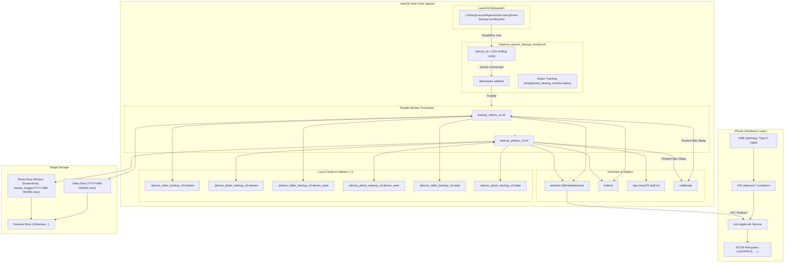
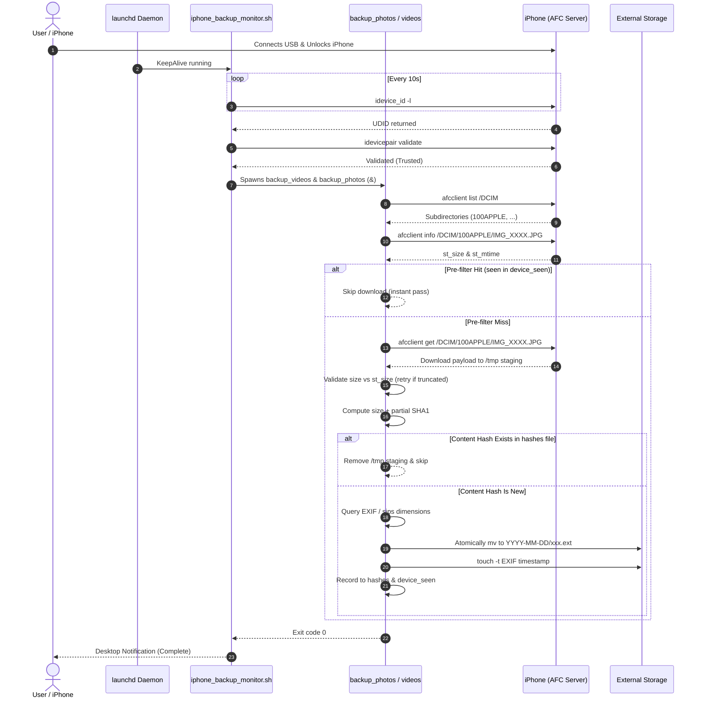

# Architecture & Technical Design
**Author**: Vaibhav Bhootna  
**Repository**: [https://github.com/vbv611/iphone-auto-backup](https://github.com/vbv611/iphone-auto-backup)

## 1. System Overview

`iphone-auto-backup` is an automated, daemon-driven macOS backup utility that extracts photos and videos from an iOS device over USB via Apple File Conduit (AFC), deduplicates media using partial content hashing, organizes files chronologically based on EXIF metadata, and transfers them into an external drive without relying on Apple Photos, iCloud, or proprietary third-party backup software.

### High-Level Architecture Diagram

---

## 2. Core Components

### 2.1 Configuration Layer (`config.sh`)
* **Role**: Single source of configuration for target directories, file extension filters, optional post-processing hooks, and tool path resolution.
* **Key Variables**:
  * `BACKUP_ROOT`: Path to destination folder for videos (e.g. `/Volumes/MyDisk/iPhone_Videos`).
  * `PHOTO_BACKUP_ROOT`: Path to destination folder for photos (e.g. `/Volumes/MyDisk/iPhone_Photos`).
  * `VIDEO_EXTENSIONS`: Space-separated list of recognized video file extensions (e.g. `MOV MP4 M4V 3GP AVI MKV`).
  * `PHOTO_EXTENSIONS`: Space-separated list of recognized image file extensions (e.g. `JPG JPEG HEIC PNG GIF`).
  * `AUTO_REFRESH_INDEX`: Boolean flag (`0` or `1`) indicating whether to execute sibling indexers.
* **Path Resolution**: The `_iphone_resolve_tool()` function resolves CLI paths across Apple Silicon (`/opt/homebrew/bin`), Intel Mac (`/usr/local/bin`), and general `PATH`.
* **Volume Safety Guard**: `ensure_backup_root()` verifies that `/Volumes/<DiskName>` is an active mount point to prevent creating directory trees on the internal boot disk when the external drive is unplugged.

### 2.2 Background Daemon (`iphone_backup_monitor.sh`)
* **Role**: Persistent daemon supervised by `launchd`.
* **Execution Model**: Runs an infinite loop with a 10-second sleep (`IPHONE_MONITOR_INTERVAL`).
* **Connection State Machine**:
  1. `watching`: No device connected or waiting for connection.
  2. `waiting_trust`: Device detected via `idevice_id -l`, but `idevicepair validate` fails (user has not clicked "Trust This Computer" or unlocked the device).
  3. `running`: Triggers both `backup_videos_v3.sh` and `backup_photos_v3.sh` in background subshells (`&`) and waits for both PIDs.
  4. `watching_connected`: Device has already been backed up during the current physical connection session.
  5. `done` / `failed`: Status logged to `/tmp/iphone_backup_monitor.status`.

### 2.3 Worker Scripts (`backup_videos_v3.sh` & `backup_photos_v3.sh`)
* **Concurrency Lock**: Employs `mkdir /tmp/iphone_*_backup_v3.lockdir` as an atomic filesystem mutex with PID recording and stale process eviction.
* **Sleep Suppression**: Launches `caffeinate -dims -t 0` in the background; terminated upon script exit via bash `trap`.
* **Directory Enumeration**:
  * Queries `afcclient list /DCIM` to find Apple-specific subdirectories matching `^[0-9]+APPLE$`.
  * Queries `afcclient list /DCIM/<dir>` to list all media items.
* **Two-Stage Deduplication**:
  1. *Stage 1 (Pre-filter)*: `device_seen` check against `${src_path}|${dev_size}` to skip downloads without network/disk overhead.
  2. *Stage 2 (Content Hash)*: Downloads file to temporary staging (`/tmp/...`), computes size + partial SHA1 hashes, and verifies against local hash database.
* **Chronological Routing & EXIF Tag Parsing**:
  * Evaluates `DateTimeOriginal`, `CreateDate`, or `MediaCreateDate` using `exiftool -s3 -d "%Y-%m-%d"`.
  * Fallback chain: Filename pattern matching (`IMG_YYYYMMDD_`) $\to$ Device filesystem modification time (`st_mtime`) $\to$ `_unknown_date`.
* **Photo Categorization** (Photos only):
  * Employs macOS `sips` to probe pixel dimensions.
  * Classifies into:
    * `Photos`: Native camera formats (`HEIC`/`HEIF`), camera sensor resolutions, or files with camera `Make`/`Model` EXIF.
    * `Screenshots`: PNG/JPG matching exact iOS/iPadOS/macOS device screen pixel dimensions.
    * `Saved_Images`: GIFs, WebP, or images from web/social media that lack camera EXIF and screen dimensions.
* **Sequential Archiving & File Timestamping**:
  * Targets `$TARGET_ROOT/<Category>/<YYYY-MM-DD>/<seq>.<ext>`.
  * Identifies highest sequence number and writes the next index (e.g. `001.jpg`, `002.jpg`).
  * Sets file access and modification times via `touch -t <YYYYMMDDHHMM.SS>` to ensure local files match capture time.

### 2.4 Image Capture & External Folder Importer (`import_image_capture.sh`)
* **Role**: Ingests, reorganizes, and indexes existing media previously transferred via Apple Image Capture, Finder, or digital camera cards onto an external volume.
* **Modes**:
  * `--copy`: Reads source files, extracts EXIF shoot dates, categorizes photos (`Photos/`, `Screenshots/`, `Saved_Images/`), moves `.AAE` edit sidecars alongside corresponding images, writes to standardized `$BACKUP_ROOT` and `$PHOTO_BACKUP_ROOT`, and records partial SHA1 hashes in local databases.
  * `--move`: Same as `--copy`, but moves original files to conserve external drive capacity.
  * `--index-only`: Reads files in-place without moving or copying, calculating and appending hashes to prevent duplicate downloads when the iPhone connects.
  * `--dry-run`: Previews the operations without mutating files or database records.

### 2.5 Hash Index Rebuilder (`rebuild_hash_index.sh`)
* **Role**: Scans an existing backup drive directory tree and regenerates corrupted or missing `~/.iphone_*_backup_v3.hashes` index files using the identical partial SHA1 algorithm.

---

## 3. Data Flow & Execution Pipeline

---

## 4. State Management and Filesystem Artifacts

| Path | Format | Lifetime | Purpose |
| :--- | :--- | :--- | :--- |
| `/tmp/iphone_backup_monitor.status` | Key-Value (`state`, `device`, `detail`, `updated_at`) | Transient | Exposes monitor state to CLI/UI |
| `/tmp/iphone_backup_monitor.lockdir` | Directory + `pid` file | Ephemeral | Prevents duplicate monitor daemons |
| `/tmp/iphone_video_backup_v3.lockdir` | Directory + `pid` file | Ephemeral | Prevents concurrent video backup runs |
| `/tmp/iphone_photo_backup_v3.lockdir` | Directory + `pid` file | Ephemeral | Prevents concurrent photo backup runs |
| `/tmp/iphone_video_backup_v3_tmp/` | Flat staging directory | Per-run | Downloads files prior to hashing |
| `/tmp/iphone_photo_backup_v3_tmp/` | Flat staging directory | Per-run | Downloads files prior to hashing |
| `~/.iphone_video_backup_v3.hashes` | Line-delimited hashes (`size_head_tail`) | Persistent | Dedup lookup table for videos |
| `~/.iphone_photo_backup_v3.hashes` | Line-delimited hashes (`size_head_tail`) | Persistent | Dedup lookup table for photos |
| `~/.iphone_video_backup_v3.device_seen` | Line-delimited (`path\|size`) | Persistent | Fast-path prefilter index |
| `~/.iphone_photo_backup_v3.device_seen` | Line-delimited (`path\|size`) | Persistent | Fast-path prefilter index |
| `~/.iphone_video_backup_v3.state` | Key-Value status & progress | Persistent | Progress reporting (phase, counts) |
| `~/.iphone_photo_backup_v3.state` | Key-Value status & progress | Persistent | Progress reporting (phase, counts) |
| `/tmp/iphone_backup_manual.trigger` | Sentinel empty file | One-shot | Forces immediate backup cycle |

